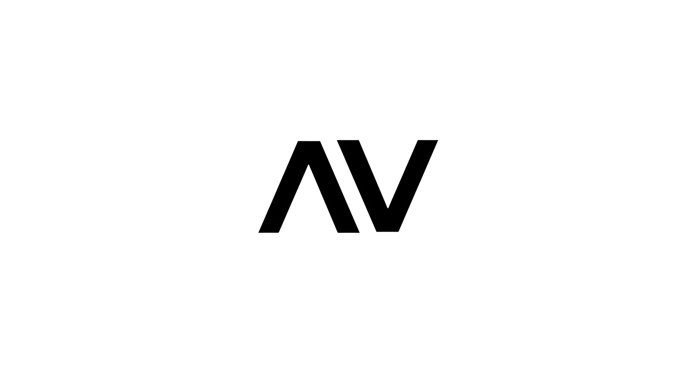

# 🌌 AiVerse

<p align="center">
  <strong>The Citation-Backed AI Knowledge Encyclopedia & Frontier Model Intelligence Radar.</strong>
</p>

<p align="center">
  An open-source, verifiable atlas of 576+ foundation models, frameworks, datasets, and platforms — complete with live benchmark telemetry, ecosystem family trees, interactive model playground, and native Agentic Resource Discovery.
</p>

<p align="center">
  <a href="https://aiverse.frozenn.in"></a>
  <a href="https://github.com/Frozen-47/AiVerse/stargazers"></a>
  <a href="https://github.com/Frozen-47/AiVerse/blob/main/LICENSE"></a>
  <a href="https://aiverse.frozenn.in/.well-known/ard.json"></a>
</p>

<p align="center">
  
  
  
  
  
  
  
  
</p>

<p align="center">
  <a href="https://aiverse.frozenn.in">
    
  </a>
</p>

---

## 💡 Why AiVerse?

The artificial intelligence landscape moves at breakneck speed. Generic link directories and static listicles decay within weeks, lack architectural context, and offer zero verifiable citations.

**AiVerse solves this by treating AI knowledge as an engineering artifact:**

1. 📚 **Citation-Backed Encyclopedia**: Over 576+ verified AI assets. Every entry details parameter classes, context windows, license terms, benchmark scores, architectural blueprints, and direct provenance links.
2. 📊 **Frontier Intelligence Leaderboard**: Ingests live benchmark flight data from Artificial Analysis and OpenRouter, tracking Intelligence Index, cost-per-task, time-to-first-token, throughput, and Briefcase Elo across top reasoning models.
3. 🌳 **Model Ecosystem Portfolios**: Traces hierarchical lineage across major AI labs (DeepSeek, OpenAI, Anthropic, Google Gemini, Meta Llama, Mistral, Alibaba Qwen, Kimi, Microsoft Phi).
4. 🤖 **Built for Both Humans & Autonomous Agents**: Native compliance with [Agentic Resource Discovery (ARD 1.0)](https://agenticresourcediscovery.org) and [llms.txt](https://llmstxt.org), allowing coding agents (Claude Code, Cursor, Windsurf, Devin) to index, query, and verify catalog tools via standard endpoints.
5. ⚡ **Vox Assistant & Live Model Playground**: Instant streaming prompt inference and token latency profiling running directly on Groq's LPU inference engine.

---

## ⚡ AiVerse Daily AI Radar

<!-- AI_RADAR:START -->
### ⚡ AiVerse AI Radar (2026-11-27)
| Metric | Status / Count |
| :--- | :--- |
| 📥 **Queued for Review** | **ERNIE 5.5 Flash Preview** (`Model`), **Google: Gemini Omni 1.2 Flash** (`Model`), **Inkling-2-Mini-GSQ-RCO-GGUF** (`Model`), **youtube** (`Dataset`) |
| 🌟 **Tool of the Day** | **TensorFlow** (Google DeepMind) — [Explore](https://www.tensorflow.org) |
| 🗄️ **Catalog Entries** | **766** AI assets tracked (368 featured) |
| 🔥 **Top Trending Model** | [JT-35B-Flash](https://artificialanalysis.ai/models/jt-35b-flash) |
| 📜 **Top Daily Paper** | [InitFree-SfM: When Initialization-Free Bundle Adju...](https://huggingface.co/papers/2611.31516) |
| 🛡️ **Catalog Links Checked** | **24/25** operational |
| 🕒 **Last Synchronized** | `Fri, 27 Nov 2026 10:25:39 GMT` |

*Full intelligence metrics and paper summaries available in [AI_RADAR.md](AI_RADAR.md).*
<!-- AI_RADAR:END -->

---

## 🚀 Key Pillars & Core Features

### 1. 🗄️ Comprehensive Verified Catalog
* **Granular Taxonomy**: Filter dynamically across `AI`, `Model`, `Dataset`, `Framework`, and `Platform`.
* **Deep Architectural Profiles**: Inspect parameter scale, tokenizer architecture, training dataset lineage, context windows (from 8k to 1M+ tokens), and evaluation metrics.
* **Instant Command Palette (`⌘K` / `Ctrl+K`)**: Rapid keyboard-first fuzzy search across all 576+ models, creators, and tags with zero lag.

### 2. 🏆 AI Frontier Benchmark Leaderboard
* Ingests real-world telemetry across top frontier models (Claude Fable 5.2, GPT-6.2 Astra, Gemini 4 Carbon, Claude Opus 5.5, Llama 3.3).
* Compares:
  * **Intelligence Index**: Aggregate multi-benchmark reasoning strength.
  * **Cost Per Task**: Dollar cost required to execute standard agentic reasoning workflows.
  * **Time Per Task & Latency**: Processing speed and time-to-first-answer-token (`TTFT`).
  * **Briefcase Elo**: Normalized coding and task automation rating.

### 3. ⚔️ Comparison Arena
* Perform side-by-side technical, architectural, licensing, and latency comparisons of any two frontier assets (e.g. `DeepSeek-V3` vs. `Llama 3.3 70B`, or `PyTorch` vs. `JAX`).

### 4. 🧙‍♂️ Discovery Wizard
* An interactive recommendation advisor that analyzes your technical use case, project scope, target tech stack, and license requirements (MIT, Apache 2.0, Commercial, Open Weights) to match you with ideal tools.

### 5. 💬 Vox AI Assistant & Inference Playground
* Context-aware conversational intelligence powered by Groq LPU streaming inference.
* Ask questions about model architectures, compare benchmarks on the fly, or test live prompts with microsecond streaming token feedback.

### 6. 🤖 Native Agentic Resource Discovery (ARD & llms.txt)
* **`/.well-known/ard.json`**: ARD 1.0 JSON manifest exposing machine-readable tool capabilities, representative queries, and API endpoints for autonomous agents.
* **`/llms.txt`**: Markdown guide following the llmstxt.org standard, enabling LLMs to navigate and cite AiVerse resources seamlessly.

---

## 🛠️ Tech Stack & Architecture

| Layer | Technologies |
| :--- | :--- |
| **Frontend Framework** | React 19, TypeScript 5.8, Vite 8.0 |
| **Styling & Animation** | Tailwind CSS v4, Lucide Icons, Canvas 2D Harmonic Waves |
| **Database & Auth** | Supabase (PostgreSQL with Row Level Security, OAuth, User Preferences) |
| **AI Inference** | Groq SDK (LPU Hardware Accelerator, ultra-low latency token streaming) |
| **Agentic Standards** | Agentic Resource Discovery (ARD 1.0), llmstxt.org Spec |
| **Testing & CI/CD** | Vitest (23 unit tests), Automated GitHub Actions Daily Pulse, Vercel Edge |
| **Performance** | 100/100 Accessibility, 100/100 Best Practices, 100/100 SEO, 4/4 Agentic Browsing |

---

## 💻 Local Development Quickstart

### Prerequisites
* **Node.js**: v20 or higher
* **npm** or **pnpm**
* **Git**

### 1. Clone the Repository
```bash
git clone https://github.com/Frozen-47/AiVerse.git
cd AiVerse
```

### 2. Install Dependencies
```bash
npm install
```

### 3. Environment Setup
Create a `.env` file in the project root (optional for basic local browsing, required for live chat & admin):
```env
VITE_SUPABASE_URL=https://your-project.supabase.co
VITE_SUPABASE_ANON_KEY=your-anon-key
GROQ_API_KEY=your-groq-api-key
```

### 4. Run the Dev Server
```bash
npm run dev
```
Open [http://localhost:5173](http://localhost:5173) in your browser.

### 5. Run Tests & Production Build
```bash
# Execute unit test suite
npm run test

# Run typechecking and production bundling
npm run build
```

---

## 🗺️ Project Roadmap

- [x] **Core Catalog Engine**: 576+ entries with architectural blueprints and citations.
- [x] **Frontier Leaderboard**: Benchmark flight data integration from Artificial Analysis.
- [x] **Agentic Web Standards**: ARD 1.0 (`ard.json`) and `llms.txt` integration.
- [x] **Lighthouse Core Web Vitals**: 100% Accessibility, SEO, Best Practices, and CLS 0.
- [x] **Comparison Arena & Discovery Wizard**: Interactive tool selection engines.
- [ ] **Public REST & GraphQL API**: Direct programmatic access for autonomous developers.
- [ ] **Community Evaluation Reviews**: Peer-reviewed reproducible benchmark submissions.
- [ ] **CLI Companion (`aiverse-cli`)**: Terminal query client for models and framework specs.

---

## 🤝 Contributing & Community

AiVerse is built by and for the global AI community. Whether you want to:
* 📝 Add newly released models, datasets, or platforms
* 📊 Submit updated benchmark figures and citations
* 🎨 Enhance UI components and interactive visualizations
* 🐛 Report edge cases or bugs

We welcome pull requests! Check out our [Contributing Guide](Contributing.md) to get started.

- **GitHub Issues**: [Open an issue or feature proposal](https://github.com/Frozen-47/AiVerse/issues)
- **Live Platform**: [aiverse.frozenn.in](https://aiverse.frozenn.in)
- **Contact**: [frozennheart47@gmail.com](mailto:frozennheart47@gmail.com)

---

<p align="center">
  <strong>Built with precision for builders, researchers, and autonomous agents exploring the artificial frontier.</strong><br>
  <sub>MIT License • © 2026 AiVerse Contributors</sub>
</p>
